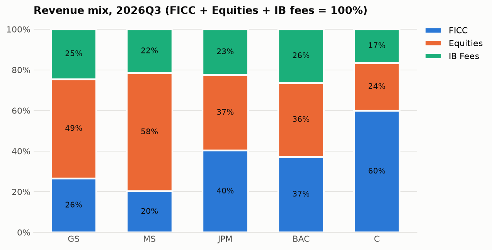
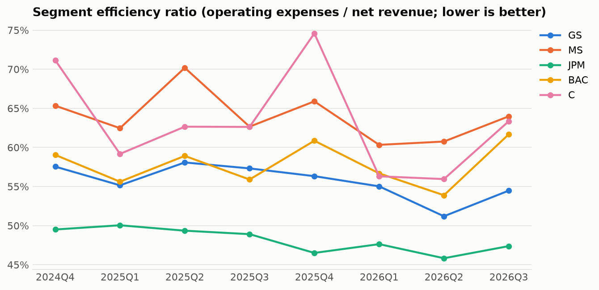
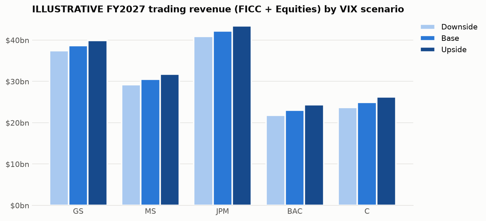

# Investment Banking & Trading Peer Benchmarking

A small, end-to-end finance analytics pipeline that benchmarks five U.S. bulge-bracket banks
— **Goldman Sachs (GS), Morgan Stanley (MS), JPMorgan Chase (JPM), Bank of America (BAC) and Citigroup (C)** —
across **FICC, Equities and Investment Banking fees** over the last 8 reported quarters (2024Q4–2026Q3).
It covers each bank's markets/banking segment P&L, tests how much market volatility explains
trading revenue, and produces an Excel report and Tableau-ready data that serve as a single source of truth.

> **Data integrity rule:** every bank figure is a **reported** number read from the bank's own SEC filings
> (earnings-release financial supplements, 10-Qs, recast 8-Ks), stored with the exact source URL and the table it
> came from. Nothing is estimated, interpolated or back-calculated. If a value isn't disclosed, it stays blank and the
> pipeline flags it.

---

## Contents
1. [Business questions](#1-business-questions)
2. [Data sources](#2-data-sources)
3. [How each bank reports (label & segment mapping)](#3-how-each-bank-reports-label--segment-mapping)
4. [Segment comparability caveats](#4-segment-comparability-caveats)
5. [Methodology](#5-methodology)
6. [How to run](#6-how-to-run)
7. [Outputs](#7-outputs)
8. [Key findings](#8-key-findings)
9. [Limitations](#9-limitations)
10. [Project structure](#10-project-structure)
11. [Design decisions](#11-design-decisions)
12. [How AI was used in this project](#12-how-ai-was-used-in-this-project)

---

## 1. Business questions

A markets-division Finance & Strategy team needs to answer, every quarter:

| # | Question | Where it's answered |
|---|----------|---------------------|
| 1 | **Where do we win share?** Peer-set share, YoY growth and revenue mix across FICC, Equities and IB fees | `src/benchmarking.py` |
| 2 | **How efficiently do we convert revenue into profit?** Efficiency ratio, pre-tax margin, operating leverage, ROE | `src/segment_pnl.py` |
| 3 | **How much of trading revenue is just the market?** Sensitivity of FICC + Equities revenue to VIX | `src/regression.py` |
| 4 | **What could next year look like?** Base / Upside / Downside trading revenue under VIX scenarios | `src/forecast.py` |
| 5 | **One version of the truth** for leadership: a formatted Excel pack plus a Tableau dashboard feed | `src/export_excel.py`, `data/processed/` |

## 2. Data sources

| Data | Source | File |
|------|--------|------|
| FICC, Equities, IB fees revenue | Each bank's quarterly **financial supplement** / 10-Q / recast 8-K, filed on [SEC EDGAR](https://www.sec.gov/edgar/search/) | `data/raw/peer_revenue.csv` (120 rows) |
| Segment net revenue, operating expenses, pre-tax income, ROE | Same filings, segment results pages | `data/raw/segment_pnl.csv` (56 rows) |
| VIX | FRED series [`VIXCLS`](https://fred.stlouisfed.org/series/VIXCLS) (Cboe Volatility Index, daily close) | `data/raw/vix.csv`, averaged to calendar quarters |

**Documents used** (all filed on SEC EDGAR, 8-K exhibits unless noted):

| Bank | Documents | Basis |
|---|---|---|
| GS | Segment-recast 8-K (Jan 2026), 4Q25 earnings presentation, 1Q26–3Q26 Form 10-Qs | All quarters on the post-4Q25 segment definition |
| MS | 4Q25, 1Q26, 2Q26, 3Q26 Financial Supplements | GAAP |
| JPM | 4Q25, 1Q26, 2Q26, 3Q26 Earnings Release Financial Supplements | Managed basis; prior periods as revised by JPM |
| BAC | Q4 2025, Q1–Q3 2026 Supplemental Information | Segment results on FTE basis |
| C | 4Q25 Historical (recast) supplement, 1Q26, 2Q26, 3Q26 Quarterly Financial Data Supplements | Recast for Citi's 1Q26 segment changes |

For each quarter the **most recent filing that shows it** is used, so restated figures are applied consistently.
Overlapping quarters were cross-checked across filings and agree. Every row carries its `source_url`, and the `notes`
column names the document and table. The Excel **Data Sources** sheet lists all of them.

All figures are in **USD millions**, for the quarter (not year-to-date). `reported_roe_pct` is a percent number
(e.g. `20.7` = 20.7%).

## 3. How each bank reports (label & segment mapping)

The five banks use different names for the same businesses, so each row keeps the bank's own label
(`reported_label`) next to a standard `business_line`. The original **VERIFY** items were resolved against the filings:

### Business-line labels

| Standard line | GS | MS | JPM | BAC | C |
|---|---|---|---|---|---|
| **FICC** | FICC | Fixed income (sales & trading) | Fixed Income Markets | FICC sales & trading, **reported basis incl. net DVA** (ex-DVA in notes) | Fixed Income Markets |
| **Equities** | Equities | Equity (sales & trading) | Equity Markets | Equities sales & trading, reported basis | Equity Markets |
| **IB_Fees** | Investment banking fees | Investment banking *revenue* (advisory + underwriting) | Investment banking fees (CIB income-statement line, gross) | Total Corporation IB fees **incl. self-led deals** (gross; net in notes) | Investment banking fees (Banking segment fee line) |

Choices worth knowing:
- **MS** lists "Equity" and "Fixed income" twice: once as underwriting inside Investment banking, once as sales & trading.
  The sales & trading lines are used.
- **JPM** also shows an "Investment Banking" revenue line under *Revenue by Business*. That is a different measure;
  the gross IB fees line is used, and the other value is in the notes.
- **Citi** introduced a broader "Investment banking revenues" headline from 2Q26. The narrower "Investment banking
  fees" line is used for all 8 quarters for consistency.

### Segments used for the P&L

| Bank | Segment(s) | Notes |
|---|---|---|
| GS | Global Banking & Markets | Recast from 4Q25: transaction banking moved into GBM |
| MS | Institutional Securities | Single segment |
| JPM | Commercial & Investment Bank | Includes the former Commercial Banking (2024 reorganisation) |
| BAC | Global Banking **+** Global Markets | Two segments, **summed** by the pipeline |
| C | Banking **+** Markets | Two segments, **summed**. Services excluded. Recast in 1Q26 |

### Segment ROE

| Bank | What is reported | Used as `reported_roe_pct` |
|---|---|---|
| GS | Return on average common equity for GBM (one decimal) | Yes. 2024Q4 is blank because the recast filing doesn't state it |
| MS | Return on average common equity for ISG (whole %) | Yes |
| JPM | ROE for CIB (whole %) | Yes |
| BAC | Return on average *allocated capital* per segment | No. Kept in notes; two segments can't be combined anyway |
| C | RoTCE per segment | No. Two segments can't be combined anyway |

## 4. Segment comparability caveats

Peer benchmarking is only as good as the comparability of what's compared. Known differences:

- **Segment scope differs.** JPM's Commercial & Investment Bank includes middle-market commercial banking, Payments
  and Securities Services. GS GBM and MS ISG are much purer markets + advisory businesses. Efficiency ratios and
  margins therefore reflect business mix as much as execution.
- **Two-segment banks.** BAC and C split banking and markets into separate segments. Summing them is the closest
  like-for-like, but it can include corporate lending and transaction services that GS and MS don't hold in GBM/ISG.
  Citi's Services segment is excluded entirely.
- **IB fees aren't defined identically.** MS reports Investment Banking *revenue*. BAC's total IB fees are shared
  between two segments. Some banks report gross fees and others net of fee-sharing.
- **Revenue basis.** Some banks report on a managed / fully-taxable-equivalent basis. BAC shows sales & trading
  with and without net DVA. Pick one basis per bank, note it in `notes`, and keep it consistent across quarters.
- **Reorganisations.** Segment definitions change (e.g. JPM 2024, Citi 2024). Use restated prior periods where the
  bank provides them, and note it.
- **Peer-set share ≠ industry share.** Share is measured against these five banks only. It excludes European banks,
  boutiques and other dealers, so it overstates every bank's true wallet share. It is labelled "peer-set share" everywhere.

## 5. Methodology

All calculations are per bank and quarter unless noted. "Prior year" always means **the same quarter one year earlier**.
It is joined on the period itself (quarter − 4), not on row position, so a missing quarter can't silently compare
the wrong periods.

### Revenue benchmarking (`benchmarking.py`)

| Metric | Formula |
|---|---|
| Peer-set share | bank revenue ÷ sum of the 5 banks' revenue (same quarter, same business line) |
| Share change (bps) | (share − prior-year share) × 10,000 |
| YoY growth | revenue ÷ prior-year revenue − 1 |
| Revenue mix | line revenue ÷ bank's FICC + Equities + IB fees that quarter |

### Segment P&L and KPIs (`segment_pnl.py`)

| Metric | Formula | Better |
|---|---|---|
| Efficiency ratio | operating expenses ÷ net revenue | lower |
| Pre-tax margin | pre-tax income ÷ net revenue | higher |
| Revenue / expense YoY growth | vs. same quarter last year | — |
| Operating leverage ("jaws") | revenue growth − expense growth (% pts) | higher |
| ROE | as reported, never calculated | higher |

**KPI scorecard:** banks are ranked 1–5 on each metric for (a) the latest quarter and (b) the trailing 4 quarters.
Trailing ratios use *summed* revenue and expenses (not an average of quarterly ratios), so a large quarter correctly
carries more weight. Overall rank = average of the available metric ranks.

### Validation (`validate.py`)

| Check | Level |
|---|---|
| Missing columns, unknown bank / business line, bad quarter format | Critical: pipeline stops |
| Expected bank × quarter × line row not present | Critical |
| Missing or non-numeric values | Critical |
| Duplicate rows | Critical |
| Negative revenue or expenses | Critical |
| Missing `source_url` | Critical |
| Pre-tax income ≠ net revenue − operating expenses by more than 5% of revenue | Review (usually the credit-loss provision) |
| Quarter-over-quarter change > 40% | Review manually (typo, restatement, or a genuine move) |

Thresholds live in `src/config.py`.

### VIX regression (`regression.py`)

```
trading_revenue[bank, q] = α[bank] + β · avg_VIX[q] + ε
```

- `trading_revenue` = FICC + Equities ($mm). `avg_VIX` = mean daily VIX close in the calendar quarter.
- **Bank fixed effects** (`α[bank]`) absorb structural size differences (JPM ≫ C), so β is identified from how each
  bank's revenue moves *over time* with volatility.
- OLS via `statsmodels`, with **HC1 robust standard errors** because residual variance scales with bank size.
- **Illustrative only.** There are ~40 observations (5 banks × 8 quarters), and VIX takes just **8 distinct values**.
  Rates/FX volatility, client activity and financing balances are omitted.

### Scenario forecast (`forecast.py`)

```
run_rate      = average quarterly trading revenue, trailing 4 quarters
FY forecast   = 4 × [ run_rate + β × (scenario VIX − trailing average VIX) ]
```

| Scenario | VIX assumption (editable at the top of `forecast.py`) |
|---|---|
| Base | trailing 4-quarter average VIX (or a number you set in `BASE_VIX`) |
| Upside | Base + 5 points (higher volatility → more client activity) |
| Downside | Base − 5 points |

This is an **illustrative planning model, not a prediction**. It holds market share, mix and strategy constant.
Every assumption is written to the Excel **Assumptions** sheet.

## 6. How to run

```bash
# 1. Set up
python -m venv .venv
source .venv/bin/activate          # Windows: .venv\Scripts\activate
pip install -r requirements.txt

# 2. Check the code (uses synthetic test data only)
python -m pytest

# 3. Run everything on the sourced data in data/raw/
python src/main.py
```

`main.py` runs **validate → benchmarking → segment P&L → regression → forecast → Tableau CSVs → Excel → charts**.
If an input is missing or a critical check fails, it prints exactly which rows to fix and exits with code 1. No
output is produced from incomplete data.

**Rolling forward a quarter:**
1. Set `LATEST_QUARTER` in `src/config.py`.
2. Run `python src/make_templates.py` to regenerate blank templates for the new window.
3. Add the new quarter's rows from the latest filings, with source URLs.
4. Refresh `data/raw/vix.csv` from FRED (Download → CSV; the full series is fine, and the loader keeps only the
   quarters it needs).

## 7. Outputs

### Excel report: `outputs/ib_trading_peer_benchmarking.xlsx`

| Sheet | Contents |
|---|---|
| Executive Summary | Latest-quarter peer-set share by line, trading revenue & YoY, efficiency, margin, ROE, overall KPI rank, base-case forecast, VIX headline |
| Market Share | Peer-set share by bank × quarter for each line, plus YoY change in bps |
| YoY Growth | Revenue growth vs. same quarter last year |
| Revenue Mix | Mix % and underlying $mm |
| Segment P&L | Net revenue, opex, pre-tax income and all KPIs by bank × quarter |
| KPI Scorecard | Rankings for latest quarter and trailing 4Q |
| Forecast Scenarios | Downside / Base / Upside FY trading revenue by bank + detail |
| Assumptions | Every forecast assumption + regression statistics |
| Data Sources | Source URL for every figure, plus FRED |

Formats: `$mm` as `#,##0`, ratios as `0.0%`, share change as `+25 bps`. Headers are bold, panes are frozen and columns sized.

### Tableau extracts: `data/processed/`

Tidy, long-format CSVs (one row per observation) for a one-page executive dashboard in Tableau Public:

| File | Grain | Key columns |
|---|---|---|
| `revenue_benchmarking.csv` | bank × quarter × business line | `revenue_usd_mm`, `yoy_growth`, `peer_set_share`, `peer_set_share_change_bps`, `revenue_mix` |
| `segment_kpis.csv` | bank × quarter | `net_revenue_usd_mm`, `operating_expenses_usd_mm`, `pretax_income_usd_mm`, `efficiency_ratio`, `pretax_margin`, `operating_leverage`, `reported_roe_pct` |
| `kpi_scorecard.csv` | period × bank | metric values, `rank_*`, `overall_rank` |
| `forecast_scenarios.csv` | bank × scenario | `scenario_vix`, `run_rate_quarterly_usd_mm`, `forecast_fy_trading_revenue_usd_mm`, `change_vs_trailing_4q` |
| `vix_quarterly.csv` | quarter | `avg_vix`, `trading_days` |

Ratios are stored as decimals (0.25 = 25%), so set Tableau's number format to percentage. Suggested dashboard layout:
KPI tiles (latest-quarter trading revenue, share, efficiency) across the top; share-over-time lines filtered by
business line; efficiency ratio by bank; and the forecast scenario bars, with a single quarter filter driving all views.

### Charts: `outputs/charts/`








## 8. Key findings

_Latest quarter 2026Q3 unless stated. "Share" = share of the 5-bank peer set._

**Market share**
- **FICC:** JPM leads with **30.1%** peer-set share, roughly flat YoY (−4 bps). Citi gained the most (**+192 bps** to
  24.6%) and BAC lost the most (**−222 bps** to 14.4%, revenue −17% YoY). The peer FICC pool shrank **4.3%** YoY.
- **Equities:** the peer pool grew **43%** YoY, the standout trend of the period. GS led with **30.1%** share
  (**+510 bps**, revenue +72% YoY). MS was second at 27.1% (−43 bps). BAC (−345 bps) and Citi (−209 bps) lost ground.
- **IB fees:** GS led with **28.2%** (+317 bps) ahead of JPM at 26.3% (+154 bps). BAC was the only bank with lower IB
  fees YoY (−11%, −339 bps share).

**Segment profitability**
- **Efficiency ratio (trailing 4Q):** JPM is lowest at **46.8%**, then GS at 54.0%, against a peer median of 58.0%.
  JPM's CIB includes lending and payments, so part of that gap is business mix (see Section 4).
- **Operating leverage (trailing 4Q):** positive at 4 of 5 banks. GS had the widest jaws (revenue +31.8% vs. expenses
  ~+25%). BAC was the only bank with negative operating leverage (−1.4 pts), and in 2026Q3 its expenses grew 7% while
  revenue fell 3%.
- **ROE (trailing 4Q average, where reported):** MS 22.3%, GS 21.8%, JPM 20.0%.
- **KPI scorecard:** GS ranks #1 and JPM #2 on both the latest-quarter and trailing-4Q views.

**Volatility sensitivity**
- β ≈ **$63mm** of quarterly trading revenue per bank per VIX point, but the effect is **not statistically
  significant** (p = 0.37; 95% CI −$75mm to +$200mm). In this window volatility was not the main driver of trading
  results. 2026Q2 was the strongest trading quarter for most banks with an unremarkable average VIX of 18.3, while the
  2025Q2 VIX spike (23.6) did not produce the peak. Client activity and equities financing balances matter more than
  headline volatility.

**Outlook (illustrative)**
- Base case FY2027 peer-set trading revenue: **$159.4bn**. That equals the trailing 4-quarter run-rate, because Base VIX
  is set to the trailing average of 18.1. A ±5-point VIX swing moves each bank by about ±$1.3bn (±$6.3bn for the peer
  set), but given the weak regression fit this sensitivity should be treated as a range, not a forecast.

**So what for markets leadership**
- The equities wallet is where share is being won and lost. GS and JPM are compounding gains in both Equities and IB
  fees, while BAC is losing share across all three lines with rising costs. Strategic focus belongs on financing-led
  equities and advisory, not on betting on volatility.
- Cost discipline separates the leaders. The banks that grew revenue fastest also kept expense growth below revenue
  growth, so efficiency targets should be tracked alongside share, not separately.

_These findings are drafted from the pipeline outputs. Re-check them against the Excel report after any data change._

## 9. Limitations

- **Small sample.** 8 quarters × 5 banks. The regression and forecast are directional tools, not predictive models.
- **One driver.** Trading revenue depends on rates and FX volatility, client positioning, financing balances,
  prime brokerage and market share, none of which the VIX model captures. The weak fit (p = 0.37) shows this.
- **Comparability.** Segment scope and line definitions differ by bank (Section 4). Treat cross-bank efficiency and
  ROE comparisons as indicative.
- **Restatements.** GS (4Q25) and Citi (1Q26) recast their segments, and JPM revised some line allocations. Recast
  figures are used throughout, so earlier quarters won't match the numbers as first published.
- **Preliminary figures.** Supplement figures for the latest quarter are labelled preliminary by the banks and can be
  revised in the 10-Q.
- **Peer-set share** is not industry wallet share. Coalition Greenwich or Dealogic data would be needed for that.
- **Data extraction risk** is mitigated by source URLs, completeness checks, reconciliation, QoQ outlier flags and an
  independent spot-check (Section 12). Anyone presenting these numbers should still re-verify the key figures against
  the filings.
- **Calendar quarters** are assumed for VIX alignment. All five banks report on a calendar fiscal year.

## 10. Project structure

```
ib-trading-peer-benchmarking/
├── data/
│   ├── raw/
│   │   ├── peer_revenue_template.csv   # blank template, 120 rows (5 banks × 8 quarters × 3 lines)
│   │   ├── segment_pnl_template.csv    # blank template, 56 rows (BAC & C have two segments)
│   │   ├── peer_revenue.csv            # sourced revenue figures (120 rows)
│   │   ├── segment_pnl.csv             # sourced segment P&L (56 rows)
│   │   └── vix.csv                     # FRED VIXCLS daily series
│   └── processed/                      # Tableau extracts (generated)
├── outputs/
│   ├── ib_trading_peer_benchmarking.xlsx  # Excel report (generated)
│   └── charts/                         # PNG charts (generated)
├── src/
│   ├── config.py           # banks, quarters, paths, validation thresholds
│   ├── make_templates.py   # builds the blank templates with each bank's labels
│   ├── validate.py         # critical checks + review flags
│   ├── benchmarking.py     # peer-set share, YoY growth, revenue mix
│   ├── segment_pnl.py      # KPIs and scorecard
│   ├── regression.py       # VIX loader + fixed-effects OLS
│   ├── forecast.py         # editable VIX scenarios -> FY forecast
│   ├── export_excel.py     # formatted workbook
│   ├── charts.py           # matplotlib charts
│   └── main.py             # one command to run everything
├── tests/                  # pytest suite on clearly-labelled FAKE data
├── requirements.txt
└── pytest.ini
```

## 11. Design decisions

Choices worth explaining:

- **Fail loudly, never fill.** Missing data stops the run. Imputing a bank's revenue would make every downstream share
  and ranking wrong without anyone noticing.
- **Critical vs. review.** A missing number is always an error. A 45% QoQ jump might be real (e.g. a strong IB quarter),
  so it's flagged for a human rather than blocked.
- **Join on the period, not the row.** YoY uses `quarter − 4` as a merge key instead of `shift(4)`, which would break if
  a quarter were missing or rows were unsorted. A test covers this.
- **Sum, then divide.** Trailing-4Q efficiency is ΣOpex ÷ ΣRevenue, not the average of four ratios.
- **Don't combine what can't be combined.** Two segment ROEs can't be added, so BAC and C ROE is left blank instead of
  averaged.
- **Bank fixed effects + robust errors.** These separate "JPM is bigger" from "volatility drives revenue", and account
  for bigger banks having bigger residuals.
- **Config in one place.** Rolling forward a quarter is a one-line change in `config.py`. Scenario assumptions sit at
  the top of `forecast.py`.
- **Synthetic test data is unmistakable.** Test banks are named `FAKE_A/B/C` with `example.com` sources, so test
  numbers can never leak into real outputs.

## 12. How AI was used in this project

This project was built with AI-assisted development, using **Claude Code** as a pair programmer in my local
development environment (with Git for version control). The approach follows what the Finance & Strategy role
describes: use AI to remove manual effort, and keep human judgment and review where accuracy matters.

**Where AI accelerated the work**
- **Scaffolding:** the folder structure, module skeletons and the one-command `main.py` runner.
- **Boilerplate-heavy code:** openpyxl formatting (number formats, frozen panes, column widths) and matplotlib styling.
- **Test generation:** pytest cases drafted from formulas I specified (share sums to 100%, YoY by hand, operating
  leverage, forecast arithmetic), each with hand-checkable expected values.
- **Edge cases:** failure modes in validation such as gaps in quarters, non-numeric entries, FRED's missing-value
  marker and multi-segment banks. Each became an explicit check and test.
- **Document extraction:** AI agents searched SEC EDGAR for each bank's financial supplements and 10-Qs, read the
  segment tables, and returned every figure with its source URL and the exact table line it came from. This is the
  "automate the reporting workflow" use case: about 30 long filings reduced to two tidy CSVs.

**Controls on the AI-extracted data (where human review stays essential)**
- **Rules set up front:** read only from the bank's own filings; never estimate, interpolate or recall from memory;
  leave a figure blank if it isn't disclosed. One figure (GS 2024Q4 segment ROE) is blank for that reason.
- **Restatement handling:** the most recent filing containing each quarter is used. This surfaced the GS and Citi
  segment recasts, which would otherwise have mixed old and new definitions.
- **Automated validation:** completeness, duplicates, negatives, source URLs, the pre-tax reconciliation and QoQ
  outlier flags. Every flag was reviewed and explained, e.g. Q4→Q1 trading seasonality and Citi Banking credit-cost
  swings.
- **Independent audit:** a separate checker, not told the expected answer, re-opened the filings and re-read a sample
  of 16 figures across all five banks, including the flagged outliers: **16 of 16 matched exactly**. The audit also confirmed the right line was picked where similar figures sit side by side, e.g. BAC FICC reported (3,479) vs. ex-DVA (3,464), and JPM gross IB fees (3,005) vs. IB revenue (3,098).
- **Judgment calls stayed mine:** which line to use when a bank reports several (gross vs. net IB fees, reported vs.
  ex-DVA trading), segment comparability, summing two-segment banks, blanking non-additive ROE, and how to interpret
  results.

**What I took away:** AI is very effective at structure, formatting, test coverage and turning long filings into
structured data. It is only trustworthy when every number is traceable to a source and checked by controls a human
designed. The analyst stays accountable for the numbers.
