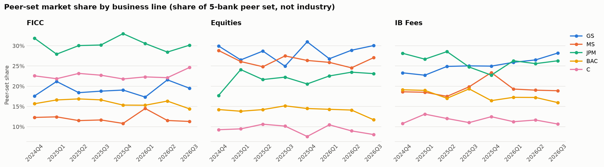

# GBM Peer Benchmarking: Trading, Investment Banking & Segment P&L

A small, end-to-end finance analytics pipeline that benchmarks five U.S. bulge-bracket banks
— **Goldman Sachs (GS), Morgan Stanley (MS), JPMorgan Chase (JPM), Bank of America (BAC) and Citigroup (C)** —
across **FICC, Equities and Investment Banking fees** over the last 8 reported quarters (2024Q4–2026Q3).
It covers each bank's markets/banking segment P&L, tests how much market volatility explains
trading revenue, and produces an Excel report and Tableau-ready data that serve as a single source of truth.

> **Data integrity rule:** every bank figure in this project is entered by hand from the bank's official
> earnings release or financial supplement, with its source URL. The code never invents, estimates
> or fills a value. If something is missing, the pipeline stops and tells you exactly which row.

---

## Contents
1. [Business questions](#1-business-questions)
2. [Data sources](#2-data-sources)
3. [How each bank reports (label & segment mapping)](#3-how-each-bank-reports-label--segment-mapping)
4. [Segment comparability caveats](#4-segment-comparability-caveats)
5. [Methodology](#5-methodology)
6. [How to run](#6-how-to-run)
7. [Outputs](#7-outputs)
8. [Key findings](#8-key-findings)
9. [Limitations](#9-limitations)
10. [Project structure](#10-project-structure)
11. [Design decisions](#11-design-decisions)
12. [How AI was used in this project](#12-how-ai-was-used-in-this-project)

---

## 1. Business questions

A GBM Finance & Strategy team needs to answer, every quarter:

| # | Question | Where it's answered |
|---|----------|---------------------|
| 1 | **Where do we win share?** Peer-set share, YoY growth and revenue mix across FICC, Equities and IB fees | `src/benchmarking.py` |
| 2 | **How efficiently do we convert revenue into profit?** Efficiency ratio, pre-tax margin, operating leverage, ROE | `src/segment_pnl.py` |
| 3 | **How much of trading revenue is just the market?** Sensitivity of FICC + Equities revenue to VIX | `src/regression.py` |
| 4 | **What could next year look like?** Base / Upside / Downside trading revenue under VIX scenarios | `src/forecast.py` |
| 5 | **One version of the truth** for leadership: a formatted Excel pack plus a Tableau dashboard feed | `src/export_excel.py`, `data/processed/` |

## 2. Data sources

| Data | Source | How it enters the project |
|------|--------|---------------------------|
| FICC, Equities, IB fees revenue | Each bank's quarterly **earnings release** and **financial supplement** (investor relations sites) | Hand-entered into `data/raw/peer_revenue.csv` |
| Segment net revenue, operating expenses, pre-tax income, ROE | Same documents, segment pages | Hand-entered into `data/raw/segment_pnl.csv` |
| VIX | FRED series [`VIXCLS`](https://fred.stlouisfed.org/series/VIXCLS) (CBOE Volatility Index, daily close) | Downloaded as CSV to `data/raw/vix.csv`, averaged to calendar quarters |

Every row carries a `source_url`. A row without one fails validation. The Excel **Data Sources** sheet lists all of them.

All figures are in **USD millions**, as reported, for the quarter (not year-to-date). `reported_roe_pct` is entered as
a percent number (e.g. `14.2` for 14.2%).

## 3. How each bank reports (label & segment mapping)

The five banks don't use the same names, so the templates pre-fill each bank's own label (`reported_label`) next to the
standard `business_line`. Items marked **VERIFY** are my best reading of each bank's terminology and should be
confirmed against the source document while entering data. The template's `notes` column flags the same rows.

### Business-line labels

| Standard line | GS | MS | JPM | BAC | C |
|---|---|---|---|---|---|
| **FICC** | FICC | Fixed Income | Fixed Income Markets | FICC (Fixed income, currencies and commodities) **VERIFY**: reported and ex-DVA versions both exist | Fixed Income Markets |
| **Equities** | Equities | Equity | Equity Markets | Equities **VERIFY**: same DVA choice | Equity Markets |
| **IB_Fees** | Investment banking fees | Investment Banking **VERIFY**: reported as revenue (advisory + underwriting), not a "fees" line | Investment Banking fees **VERIFY**: CIB vs. firmwide figure | Total Corporation investment banking fees **VERIFY**: split between Global Banking and Global Markets | Investment Banking fees **VERIFY**: Banking segment line |

### Segments used for the P&L

| Bank | Segment(s) | Notes |
|---|---|---|
| GS | Global Banking & Markets | Single segment covering IB, FICC, Equities |
| MS | Institutional Securities | Single segment |
| JPM | Commercial & Investment Bank | Single segment since the 2024 reorganisation (includes former Commercial Banking) |
| BAC | Global Banking **+** Global Markets | Two segments, **summed** by the pipeline |
| C | Banking **VERIFY** **+** Markets | Two segments, **summed**. Citi's Services segment is excluded |

### Segment ROE availability (VERIFY all)

| Bank | What is reported | How the pipeline treats it |
|---|---|---|
| GS | Return on average equity for GBM | Entered as `reported_roe_pct` |
| MS | Firm-level ROE / ROTCE; segment ROE may not be disclosed **VERIFY** | Leave blank if not reported |
| JPM | ROE for CIB | Entered as `reported_roe_pct` |
| BAC | Return on average *allocated capital* per segment **VERIFY** | Blanked automatically (two segments can't be combined) |
| C | RoTCE per segment **VERIFY** | Blanked automatically (two segments can't be combined) |

## 4. Segment comparability caveats

Peer benchmarking is only as good as the comparability of what's compared. Known differences:

- **Segment scope differs.** JPM's Commercial & Investment Bank includes middle-market commercial banking, Payments
  and Securities Services. GS GBM and MS ISG are much purer markets + advisory businesses. Efficiency ratios and
  margins therefore reflect business mix as much as execution.
- **Two-segment banks.** BAC and C split banking and markets into separate segments. Summing them is the closest
  like-for-like, but it can include corporate lending and transaction services that GS and MS don't hold in GBM/ISG.
  Citi's Services segment is excluded entirely.
- **IB fees aren't defined identically.** MS reports Investment Banking *revenue*. BAC's total IB fees are shared
  between two segments. Some banks report gross fees and others net of fee-sharing.
- **Revenue basis.** Some banks report on a managed / fully-taxable-equivalent basis. BAC shows sales & trading
  with and without net DVA. Pick one basis per bank, note it in `notes`, and keep it consistent across quarters.
- **Reorganisations.** Segment definitions change (e.g. JPM 2024, Citi 2024). Use restated prior periods where the
  bank provides them, and note it.
- **Peer-set share ≠ industry share.** Share is measured against these five banks only. It excludes European banks,
  boutiques and other dealers, so it overstates every bank's true wallet share. It is labelled "peer-set share" everywhere.

## 5. Methodology

All calculations are per bank and quarter unless noted. "Prior year" always means **the same quarter one year earlier**.
It is joined on the period itself (quarter − 4), not on row position, so a missing quarter can't silently compare
the wrong periods.

### Revenue benchmarking (`benchmarking.py`)

| Metric | Formula |
|---|---|
| Peer-set share | bank revenue ÷ sum of the 5 banks' revenue (same quarter, same business line) |
| Share change (bps) | (share − prior-year share) × 10,000 |
| YoY growth | revenue ÷ prior-year revenue − 1 |
| Revenue mix | line revenue ÷ bank's FICC + Equities + IB fees that quarter |

### Segment P&L and KPIs (`segment_pnl.py`)

| Metric | Formula | Better |
|---|---|---|
| Efficiency ratio | operating expenses ÷ net revenue | lower |
| Pre-tax margin | pre-tax income ÷ net revenue | higher |
| Revenue / expense YoY growth | vs. same quarter last year | — |
| Operating leverage ("jaws") | revenue growth − expense growth (% pts) | higher |
| ROE | as reported, never calculated | higher |

**KPI scorecard:** banks are ranked 1–5 on each metric for (a) the latest quarter and (b) the trailing 4 quarters.
Trailing ratios use *summed* revenue and expenses (not an average of quarterly ratios), so a large quarter correctly
carries more weight. Overall rank = average of the available metric ranks.

### Validation (`validate.py`)

| Check | Level |
|---|---|
| Missing columns, unknown bank / business line, bad quarter format | Critical: pipeline stops |
| Expected bank × quarter × line row not present | Critical |
| Missing or non-numeric values | Critical |
| Duplicate rows | Critical |
| Negative revenue or expenses | Critical |
| Missing `source_url` | Critical |
| Pre-tax income ≠ net revenue − operating expenses by more than 5% of revenue | Review (usually the credit-loss provision) |
| Quarter-over-quarter change > 40% | Review manually (typo, restatement, or a genuine move) |

Thresholds live in `src/config.py`.

### VIX regression (`regression.py`)

```
trading_revenue[bank, q] = α[bank] + β · avg_VIX[q] + ε
```

- `trading_revenue` = FICC + Equities ($mm). `avg_VIX` = mean daily VIX close in the calendar quarter.
- **Bank fixed effects** (`α[bank]`) absorb structural size differences (JPM ≫ C), so β is identified from how each
  bank's revenue moves *over time* with volatility.
- OLS via `statsmodels`, with **HC1 robust standard errors** because residual variance scales with bank size.
- **Illustrative only.** There are ~40 observations (5 banks × 8 quarters), and VIX takes just **8 distinct values**.
  Rates/FX volatility, client activity and financing balances are omitted.

### Scenario forecast (`forecast.py`)

```
run_rate      = average quarterly trading revenue, trailing 4 quarters
FY forecast   = 4 × [ run_rate + β × (scenario VIX − trailing average VIX) ]
```

| Scenario | VIX assumption (editable at the top of `forecast.py`) |
|---|---|
| Base | trailing 4-quarter average VIX (or a number you set in `BASE_VIX`) |
| Upside | Base + 5 points (higher volatility → more client activity) |
| Downside | Base − 5 points |

This is an **illustrative planning model, not a prediction**. It holds market share, mix and strategy constant.
Every assumption is written to the Excel **Assumptions** sheet.

## 6. How to run

```bash
# 1. Set up
python -m venv .venv
source .venv/bin/activate          # Windows: .venv\Scripts\activate
pip install -r requirements.txt

# 2. Check the code (uses synthetic test data only)
python -m pytest

# 3. Create the input files from the blank templates
cp data/raw/peer_revenue_template.csv data/raw/peer_revenue.csv
cp data/raw/segment_pnl_template.csv  data/raw/segment_pnl.csv
#    -> fill in every figure + source_url from the banks' earnings materials

# 4. Download VIX: https://fred.stlouisfed.org/series/VIXCLS
#    set the date range to cover 2024-10-01 .. 2026-09-30, Download -> CSV,
#    save as data/raw/vix.csv

# 5. Run everything
python src/main.py
```

`main.py` runs **validate → benchmarking → segment P&L → regression → forecast → Tableau CSVs → Excel → charts**.
If an input is missing or a critical check fails, it prints exactly which rows to fix and exits with code 1. No
output is produced from incomplete data.

**Rolling forward a quarter:** change `LATEST_QUARTER` in `src/config.py` and run `python src/make_templates.py`
to regenerate the templates.

## 7. Outputs

### Excel report: `outputs/gbm_peer_benchmarking.xlsx`

| Sheet | Contents |
|---|---|
| Executive Summary | Latest-quarter peer-set share by line, trading revenue & YoY, efficiency, margin, ROE, overall KPI rank, base-case forecast, VIX headline |
| Market Share | Peer-set share by bank × quarter for each line, plus YoY change in bps |
| YoY Growth | Revenue growth vs. same quarter last year |
| Revenue Mix | Mix % and underlying $mm |
| Segment P&L | Net revenue, opex, pre-tax income and all KPIs by bank × quarter |
| KPI Scorecard | Rankings for latest quarter and trailing 4Q |
| Forecast Scenarios | Downside / Base / Upside FY trading revenue by bank + detail |
| Assumptions | Every forecast assumption + regression statistics |
| Data Sources | Source URL for every figure, plus FRED |

Formats: `$mm` as `#,##0`, ratios as `0.0%`, share change as `+25 bps`. Headers are bold, panes are frozen and columns sized.

### Tableau extracts: `data/processed/`

Tidy, long-format CSVs (one row per observation) for a one-page executive dashboard in Tableau Public:

| File | Grain | Key columns |
|---|---|---|
| `revenue_benchmarking.csv` | bank × quarter × business line | `revenue_usd_mm`, `yoy_growth`, `peer_set_share`, `peer_set_share_change_bps`, `revenue_mix` |
| `segment_kpis.csv` | bank × quarter | `net_revenue_usd_mm`, `operating_expenses_usd_mm`, `pretax_income_usd_mm`, `efficiency_ratio`, `pretax_margin`, `operating_leverage`, `reported_roe_pct` |
| `kpi_scorecard.csv` | period × bank | metric values, `rank_*`, `overall_rank` |
| `forecast_scenarios.csv` | bank × scenario | `scenario_vix`, `run_rate_quarterly_usd_mm`, `forecast_fy_trading_revenue_usd_mm`, `change_vs_trailing_4q` |
| `vix_quarterly.csv` | quarter | `avg_vix`, `trading_days` |

Ratios are stored as decimals (0.25 = 25%), so set Tableau's number format to percentage. Suggested dashboard layout:
KPI tiles (latest-quarter trading revenue, share, efficiency) across the top; share-over-time lines filtered by
business line; efficiency ratio by bank; and the forecast scenario bars, with a single quarter filter driving all views.

### Charts: `outputs/charts/`

| File | Shows |
|---|---|
| `peer_set_market_share.png` | Peer-set share over time, one panel per business line |
| `revenue_mix_latest_quarter.png` | 100% stacked revenue mix by bank, latest quarter |
| `efficiency_ratio.png` | Segment efficiency ratio by bank over time |
| `forecast_scenarios.png` | FY trading revenue by bank under each VIX scenario |

<!-- After running the pipeline with real data, embed the charts here, e.g.

-->

## 8. Key findings

_To be completed once all figures have been entered and validated. Replace every [bracket]._

**Market share**
- FICC: [Bank] led peer-set share in [latest quarter] at [x]%, [up / down] [x] bps YoY, driven by [driver].
- Equities: [...]
- IB fees: [...]

**Segment profitability**
- Lowest efficiency ratio (trailing 4Q): [Bank] at [x]% vs. peer median [x]%.
- Positive operating leverage at [n] of 5 banks. [Bank] had the widest jaws at [+x] pts.

**Volatility sensitivity**
- β = [$x]mm per VIX point per bank-quarter (p = [x]). [Interpretation, and why it should be read cautiously.]

**Outlook (illustrative)**
- Base-case FY[year] trading revenue for the peer set: [$x]bn. A ±5-pt VIX swing moves that by ±[$x]bn.

**So what for GBM leadership**
- [One or two data-driven recommendations, e.g. where share gains are concentrated and whether cost growth is
  keeping pace with revenue.]

## 9. Limitations

- **Small sample.** 8 quarters × 5 banks. The regression and forecast are directional tools, not predictive models.
- **One driver.** Trading revenue depends on rates and FX volatility, client positioning, financing balances,
  prime brokerage and market share, none of which the VIX model captures.
- **Comparability.** Segment scope and line definitions differ by bank (Section 4). Treat cross-bank efficiency and
  ROE comparisons as indicative.
- **Peer-set share** is not industry wallet share. Coalition Greenwich or Dealogic data would be needed for that.
- **Manual entry risk** is mitigated by source URLs, completeness checks, reconciliation and QoQ outlier flags. It is
  not eliminated, so a second-person review of the inputs is still recommended.
- **Calendar quarters** are assumed for VIX alignment. All five banks report on a calendar fiscal year.

## 10. Project structure

```
gbm-peer-benchmarking/
├── data/
│   ├── raw/
│   │   ├── peer_revenue_template.csv   # blank template, 120 rows (5 banks × 8 quarters × 3 lines)
│   │   ├── segment_pnl_template.csv    # blank template, 56 rows (BAC & C have two segments)
│   │   ├── peer_revenue.csv            # <- you create & fill
│   │   ├── segment_pnl.csv             # <- you create & fill
│   │   └── vix.csv                     # <- downloaded from FRED
│   └── processed/                      # Tableau extracts (generated)
├── outputs/
│   ├── gbm_peer_benchmarking.xlsx      # Excel report (generated)
│   └── charts/                         # PNG charts (generated)
├── src/
│   ├── config.py           # banks, quarters, paths, validation thresholds
│   ├── make_templates.py   # builds the blank templates with each bank's labels
│   ├── validate.py         # critical checks + review flags
│   ├── benchmarking.py     # peer-set share, YoY growth, revenue mix
│   ├── segment_pnl.py      # KPIs and scorecard
│   ├── regression.py       # VIX loader + fixed-effects OLS
│   ├── forecast.py         # editable VIX scenarios -> FY forecast
│   ├── export_excel.py     # formatted workbook
│   ├── charts.py           # matplotlib charts
│   └── main.py             # one command to run everything
├── tests/                  # pytest suite on clearly-labelled FAKE data
├── requirements.txt
└── pytest.ini
```

## 11. Design decisions

Choices worth explaining:

- **Fail loudly, never fill.** Missing data stops the run. Imputing a bank's revenue would make every downstream share
  and ranking wrong without anyone noticing.
- **Critical vs. review.** A missing number is always an error. A 45% QoQ jump might be real (e.g. a strong IB quarter),
  so it's flagged for a human rather than blocked.
- **Join on the period, not the row.** YoY uses `quarter − 4` as a merge key instead of `shift(4)`, which would break if
  a quarter were missing or rows were unsorted. A test covers this.
- **Sum, then divide.** Trailing-4Q efficiency is ΣOpex ÷ ΣRevenue, not the average of four ratios.
- **Don't combine what can't be combined.** Two segment ROEs can't be added, so BAC and C ROE is left blank instead of
  averaged.
- **Bank fixed effects + robust errors.** These separate "JPM is bigger" from "volatility drives revenue", and account
  for bigger banks having bigger residuals.
- **Config in one place.** Rolling forward a quarter is a one-line change in `config.py`. Scenario assumptions sit at
  the top of `forecast.py`.
- **Synthetic test data is unmistakable.** Test banks are named `FAKE_A/B/C` with `example.com` sources, so test
  numbers can never leak into real outputs.

## 12. How AI was used in this project

This project was built with AI-assisted development, using **Claude Code** as a pair programmer in my local
development environment (with Git for version control). I used it the way the Finance & Strategy role describes: to
speed up the mechanical work while keeping the financial judgment and data accountability with me.

**Where AI accelerated the work**
- *Scaffolding:* the folder structure, module skeletons and the one-command `main.py` runner.
- *Boilerplate-heavy code:* openpyxl formatting (number formats, frozen panes, column widths) and matplotlib styling,
  which are slow to write by hand and easy to review.
- *Test generation:* drafting pytest cases from the formulas I specified (share sums to 100%, YoY by hand, operating
  leverage, forecast arithmetic). I then checked each expected value by hand.
- *Edge cases:* prompting for failure modes in validation (gaps in quarters, non-numeric entries, FRED's `.`
  missing-value marker, multi-segment banks), which became explicit checks and tests.
- *Documentation:* first drafts of docstrings and this README, edited for accuracy.

**Where human review was essential (and AI was deliberately not used)**
- *All financial data.* Every figure was sourced manually from official earnings releases and supplements. The AI was
  explicitly told not to supply or estimate any bank numbers, and the pipeline is built to reject anything unsourced.
- *Label and segment mapping.* AI-suggested mappings were treated as hypotheses and marked **VERIFY** until checked
  against each bank's own documents.
- *Methodology choices:* peer-set vs. industry share, summing two-segment banks, blanking non-additive ROE, fixed
  effects, and the decision to present the forecast as illustrative.
- *Interpreting results:* the regression's small-sample caveats and the Key Findings are my own analysis.

**What I took away:** AI is very effective for structure, formatting and test coverage. It is not a source of truth for
financial data or for judgment calls about comparability. Those stay with the analyst.
